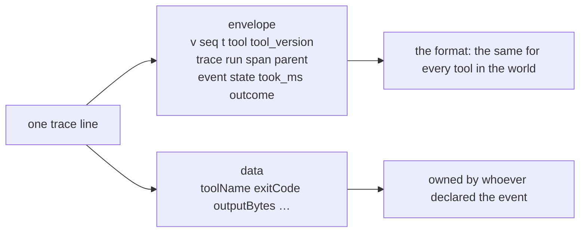
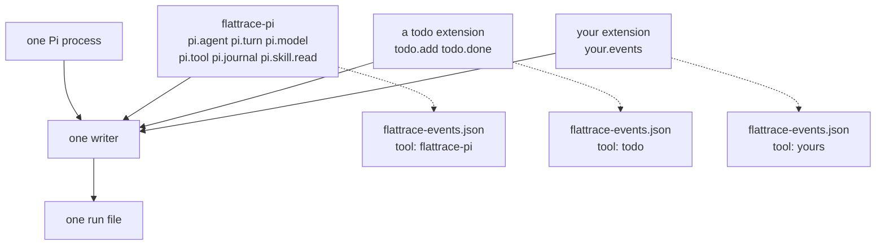
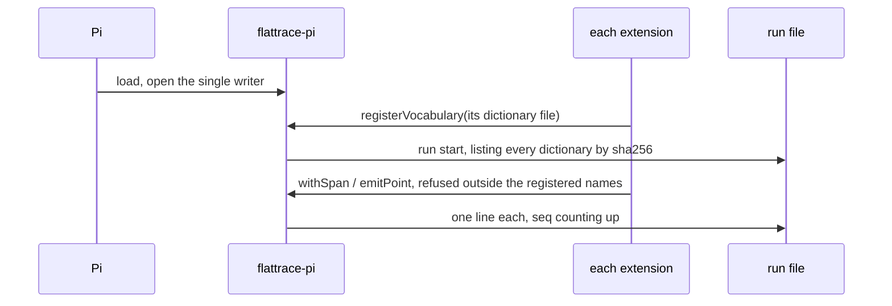

# flattrace

<picture>
  <source media="(prefers-color-scheme: dark)" srcset="https://raw.githubusercontent.com/kyraneth/flattrace/main/assets/logo/flattrace-wordmark-dark.svg">
  <source media="(prefers-color-scheme: light)" srcset="https://raw.githubusercontent.com/kyraneth/flattrace/main/assets/logo/flattrace-wordmark-light.svg">
  
</picture>

**Flat file, deep trace.** flattrace records what a tool did as small, local JSONL events: nested steps, outcomes, errors and measured durations, even across child processes. Python, Rust and TypeScript writers share one v1 envelope. Check traces, find slow steps and redact a bundle for a bug report—all offline, without a collector, server or account. Code, docs and examples are [MIT licensed](LICENSE).

## What one trace line is

Every flattrace line has the same fixed **envelope**. That's the format, and
it never changes per tool. Here is one line a Pi agent session wrote when a
`bash` tool call finished:

```json
{"v":1, "seq":41, "t":"2026-10-27T10:31:05.112Z", "tool":"flattrace-pi", "tool_version":"0.1.0",
 "trace":"ae77…", "run":"r-7f3…", "span":"58ae…", "parent":"12bc…",
 "event":"pi.tool", "state":"end", "took_ms":610, "outcome":"ok",
 "data":{"toolName":"bash","toolCallId":"c1","exitCode":0,"truncated":false,"outputBytes":2210}}
```



- **The envelope** is the same for every tool in the world. That's what makes
  flattrace one format: any reader can pair starts with ends, build the span
  tree and compute durations without knowing anything about Pi.
- **`event`** is a static name like `pi.tool`.
- **`data`** is free-form. Its meaning belongs to whoever declared the event.

So flattrace standardises the **shape** of a record, and each tool owns the
**meaning** of its events.

## The vocabulary: who says what an event means

Each owner publishes a `flattrace-events.json`, a dictionary of the events it
writes:

```json
{ "tool": "flattrace-pi",
  "events": {
    "run":        {"kind":"span"},
    "pi.tool":    {"kind":"span", "fields":{
                     "toolName":"Registered tool name",
                     "outputBytes":"Returned bytes when exposed, otherwise null",
                     "truncated":"Whether Pi cut the output (boolean)"}},
    "pi.journal": {"kind":"point", "fields":{"entryId":"Exact persisted journal entry ID"}} }}
```

**What the checker enforces** ([SPEC](SPEC.md), "Tool event files and checking"):

With or without a vocabulary, it checks structure and lifecycle: spans must
be paired, and unfinished runs and spans are reported as unfinished.
Vocabularies additionally check:

- every event name in the trace exists in the dictionary;
- its `kind` matches: a span has a start and an end, a point is a single line;
- optional `required` events, and per-`commands` requirements (for example,
  "a `capture` run must contain `capture.fetch`");
- optional detail `level`s: debug-level events can't appear in a normal-level run.

**What the checker doesn't enforce:** the payload. Field descriptions are
documentation with units, not a schema. That's deliberate: tools keep
evolving their `data` without a schema migration, and their own tests own the
meaning.

That's why the vocabulary matters so much. It's the **contract that keeps a
trace honest**. Without it, a typo like `pi.tol` passes silently; an
unfinished span is still reported.

## Several owners, one run

A real agent loads extensions. Each one writes its own events into the same
run, and each ships its own small dictionary:



**At runtime:**



1. Pi starts and loads **flattrace-pi**. The recorder prepares the process's
   single writer, without writing the `run` start yet.
2. Each extension that loads calls flattrace-pi's extension point,
   `registerVocabulary(path)`, before the run starts. Its events then go
   through the same handle (`withSpan`, `emitPoint`), which refuses any name
   outside the registered dictionaries.
3. After registration, flattrace-pi writes the `run` start line listing
   **which dictionaries this run uses**, each by fingerprint:
   ```json
   "data":{"vocabularies":[{"tool":"flattrace-pi","version":"0.1.0","sha256":"3f…"},
                           {"tool":"todo","version":"1.2.0","sha256":"a9…"}]}
   ```
4. Every event goes through the one writer, in order, with `seq` counting up.

**Checking:**

```sh
flattrace check run.jsonl --events flattrace-pi.json --events todo.json
```

- The run is validated against the **union** of the dictionaries.
- **Collisions are errors.** If two dictionaries define `todo.add`
  differently, the checker names both files. Identical duplicates are fine;
  for example, every file declares the reserved `run`.
- **Fingerprints are checked.** If the supplied `todo.json` isn't the one the
  run declared (an older or newer version), the checker says so. You always
  know exactly which contract a trace was written under, even years later.
- **No merged copy.** The run points at its dictionaries by fingerprint and
  nobody writes a combined file, because a copy could drift.
- **Who is `tool`?** The envelope `tool` is the program that wrote the run;
  each event belongs to the dictionary that declares it. Each owner's
  `required` and `commands` rules apply only to its own events.

The whole extension story in one sentence: install flattrace-pi, ship your
own small dictionary, register it, and your events sit in the same trace as
Pi's, checked together. Any other program works the same way with its own
recorder; flattrace-pi is just the one for Pi.

## Why not the alternatives

| Option | Why not |
|---|---|
| One big dictionary for every tool | Owners don't own their events; every change edits a hidden central registry. |
| A separate trace file per owner | Breaks causality: a `todo.add` must sit inside the `pi.turn` span that caused it, on one timeline with one `seq`. |
| Write a merged dictionary into each run | A second authority that drifts, and it bloats every trace. |
| Make `data` a strict schema | Payloads evolve without migrations, and each tool's tests own their meaning. |

## How this serves reading and learning

Because every event has an owner, a version and a fingerprint:

- **Readers** can trust names. `pi.tool` always means the same thing for a
  given flattrace-pi version, so recipes ("all truncated tool outputs the next
  turn relied on") are deterministic code, not guesswork.
- **Detectors and graders** write the same way: their `annotation` and
  `verdict` events come from one shared vocabulary,
  [schema/conventions-events.json](schema/conventions-events.json), and are
  checked like any other event. See [docs/learning.md](docs/learning.md).
- **Benchmarks** can tell whether two runs were written under the same
  dictionaries; comparability itself comes from the task, seed and hash block
  in [docs/learning.md](docs/learning.md).
- **Findings know where they belong:** the event's owner tells you whose code
  a problem is in.

**An honest open limit:** there is no shared monotonic clock across
processes, so exact cross-process self time is reported as unknown rather
than guessed (see [ROADMAP.md](ROADMAP.md)).

**When not to use flattrace:** it is not live monitoring. There is no
collector, sampling or alerting, only small local files studied after the
run.

## Try it

Every `json trace:` block below is a complete run file, and every
`json events:` block a complete vocabulary file: `tests/test_readme.py`
extracts them and runs each against the real checker.

The smallest run, three lines:

```json trace:first-run
{"v": 1, "seq": 0, "tool": "app", "tool_version": "0.3.0", "run": "readme-first", "trace": "f1f1f1f1f1f1f1f1f1f1f1f1f1f1f1f1", "span": "a1a1a1a1a1a1a1a1", "parent": null, "event": "run", "state": "start", "t": "2026-10-27T00:00:00.000Z", "data": {"argv": ["serve"], "host": "example", "version": "0.3.0"}}
{"v": 1, "seq": 1, "tool": "app", "tool_version": "0.3.0", "run": "readme-first", "trace": "f1f1f1f1f1f1f1f1f1f1f1f1f1f1f1f1", "span": "a1a1a1a1a1a1a1a1", "parent": null, "event": "app.ping", "state": "point", "t": "2026-10-27T00:00:01.000Z", "data": {"latency_ms": 3}}
{"v": 1, "seq": 2, "tool": "app", "tool_version": "0.3.0", "run": "readme-first", "trace": "f1f1f1f1f1f1f1f1f1f1f1f1f1f1f1f1", "span": "a1a1a1a1a1a1a1a1", "parent": null, "event": "run", "state": "end", "t": "2026-10-27T00:00:02.000Z", "data": {}, "took_ms": 12, "outcome": "ok"}
```

One owner, one dictionary. An app declares its events:

```json events:app-vocab
{
  "tool": "app",
  "events": {
    "run": {
      "kind": "span",
      "fields": {}
    },
    "app.request": {
      "kind": "span",
      "fields": {
        "route": "request route path",
        "status": "response status code (number)"
      }
    },
    "app.tool": {
      "kind": "span",
      "fields": {
        "name": "tool name",
        "outputBytes": "bytes returned (number)"
      }
    }
  }
}
```

and this run nests an `app.tool` span inside an `app.request` span:

```json trace:app-run
{"v": 1, "seq": 0, "tool": "app", "tool_version": "0.3.0", "run": "readme-app", "trace": "f1f1f1f1f1f1f1f1f1f1f1f1f1f1f1f1", "span": "a1a1a1a1a1a1a1a1", "parent": null, "event": "run", "state": "start", "t": "2026-10-27T00:00:00.000Z", "data": {"argv": ["serve"], "host": "example", "version": "0.3.0"}}
{"v": 1, "seq": 1, "tool": "app", "tool_version": "0.3.0", "run": "readme-app", "trace": "f1f1f1f1f1f1f1f1f1f1f1f1f1f1f1f1", "span": "b2b2b2b2b2b2b2b2", "parent": "a1a1a1a1a1a1a1a1", "event": "app.request", "state": "start", "t": "2026-10-27T00:00:01.000Z", "data": {"route": "/tiles"}}
{"v": 1, "seq": 2, "tool": "app", "tool_version": "0.3.0", "run": "readme-app", "trace": "f1f1f1f1f1f1f1f1f1f1f1f1f1f1f1f1", "span": "c3c3c3c3c3c3c3c3", "parent": "b2b2b2b2b2b2b2b2", "event": "app.tool", "state": "start", "t": "2026-10-27T00:00:01.000Z", "data": {"name": "render"}}
{"v": 1, "seq": 3, "tool": "app", "tool_version": "0.3.0", "run": "readme-app", "trace": "f1f1f1f1f1f1f1f1f1f1f1f1f1f1f1f1", "span": "c3c3c3c3c3c3c3c3", "parent": "b2b2b2b2b2b2b2b2", "event": "app.tool", "state": "end", "t": "2026-10-27T00:00:02.000Z", "data": {"outputBytes": 512}, "took_ms": 4, "outcome": "ok"}
{"v": 1, "seq": 4, "tool": "app", "tool_version": "0.3.0", "run": "readme-app", "trace": "f1f1f1f1f1f1f1f1f1f1f1f1f1f1f1f1", "span": "b2b2b2b2b2b2b2b2", "parent": "a1a1a1a1a1a1a1a1", "event": "app.request", "state": "end", "t": "2026-10-27T00:00:02.000Z", "data": {"status": 200}, "took_ms": 9, "outcome": "ok"}
{"v": 1, "seq": 5, "tool": "app", "tool_version": "0.3.0", "run": "readme-app", "trace": "f1f1f1f1f1f1f1f1f1f1f1f1f1f1f1f1", "span": "a1a1a1a1a1a1a1a1", "parent": null, "event": "run", "state": "end", "t": "2026-10-27T00:00:02.000Z", "data": {}, "took_ms": 11, "outcome": "ok"}
```

```sh
flattrace check app-run.jsonl --events app-vocab.json
```

```text
app-run.jsonl: 6 valid events (unverified provenance: run has no data.vocabularies)
```

Several owners: a `render` plugin ships its own dictionary,

```json events:render-vocab
{
  "tool": "render",
  "events": {
    "run": {
      "kind": "span",
      "fields": {}
    },
    "render.tile": {
      "kind": "span",
      "fields": {
        "tile": "tile identity",
        "pixels": "pixel count (number)"
      }
    }
  }
}
```

and its spans sit inside the app's request in the same run:

```json trace:app-mixed
{"v": 1, "seq": 0, "tool": "app", "tool_version": "0.3.0", "run": "readme-mixed", "trace": "f1f1f1f1f1f1f1f1f1f1f1f1f1f1f1f1", "span": "a1a1a1a1a1a1a1a1", "parent": null, "event": "run", "state": "start", "t": "2026-10-27T00:00:00.000Z", "data": {"argv": ["serve"], "host": "example", "version": "0.3.0", "vocabularies": [{"tool": "app", "version": "0.3.0", "sha256": "700e2fbe54385d8ce0ece742accffb9a625b70f435559894d028097cefbcdf1c"}, {"tool": "render", "version": "0.3.0", "sha256": "1a71b43658da828ffa6499b33fbdf0056c9826dd05161f97fbf214cbef0e0ad3"}]}}
{"v": 1, "seq": 1, "tool": "app", "tool_version": "0.3.0", "run": "readme-mixed", "trace": "f1f1f1f1f1f1f1f1f1f1f1f1f1f1f1f1", "span": "b2b2b2b2b2b2b2b2", "parent": "a1a1a1a1a1a1a1a1", "event": "app.request", "state": "start", "t": "2026-10-27T00:00:01.000Z", "data": {"route": "/tiles"}}
{"v": 1, "seq": 2, "tool": "app", "tool_version": "0.3.0", "run": "readme-mixed", "trace": "f1f1f1f1f1f1f1f1f1f1f1f1f1f1f1f1", "span": "c3c3c3c3c3c3c3c3", "parent": "b2b2b2b2b2b2b2b2", "event": "render.tile", "state": "start", "t": "2026-10-27T00:00:01.000Z", "data": {"tile": "t-7", "pixels": 65536}}
{"v": 1, "seq": 3, "tool": "app", "tool_version": "0.3.0", "run": "readme-mixed", "trace": "f1f1f1f1f1f1f1f1f1f1f1f1f1f1f1f1", "span": "c3c3c3c3c3c3c3c3", "parent": "b2b2b2b2b2b2b2b2", "event": "render.tile", "state": "end", "t": "2026-10-27T00:00:02.000Z", "data": {}, "took_ms": 6, "outcome": "ok"}
{"v": 1, "seq": 4, "tool": "app", "tool_version": "0.3.0", "run": "readme-mixed", "trace": "f1f1f1f1f1f1f1f1f1f1f1f1f1f1f1f1", "span": "b2b2b2b2b2b2b2b2", "parent": "a1a1a1a1a1a1a1a1", "event": "app.request", "state": "end", "t": "2026-10-27T00:00:02.000Z", "data": {"status": 200}, "took_ms": 9, "outcome": "ok"}
{"v": 1, "seq": 5, "tool": "app", "tool_version": "0.3.0", "run": "readme-mixed", "trace": "f1f1f1f1f1f1f1f1f1f1f1f1f1f1f1f1", "span": "a1a1a1a1a1a1a1a1", "parent": null, "event": "run", "state": "end", "t": "2026-10-27T00:00:03.000Z", "data": {}, "took_ms": 11, "outcome": "ok"}
```

```sh
flattrace check mixed.jsonl --events app-vocab.json --events render-vocab.json
```

```text
mixed.jsonl: 6 valid events
```

When owners disagree, the checker says so. A forked plugin redefines
`render.tile` with fewer fields:

```json events:render-collide
{
  "tool": "render-fork",
  "events": {
    "run": {
      "kind": "span",
      "fields": {}
    },
    "render.tile": {
      "kind": "span",
      "fields": {
        "tile": "tile identity"
      }
    }
  }
}
```

```json trace:collision-run
{"v": 1, "seq": 0, "tool": "app", "tool_version": "0.3.0", "run": "readme-collision", "trace": "f1f1f1f1f1f1f1f1f1f1f1f1f1f1f1f1", "span": "a1a1a1a1a1a1a1a1", "parent": null, "event": "run", "state": "start", "t": "2026-10-27T00:00:00.000Z", "data": {"argv": ["serve"], "host": "example", "version": "0.3.0", "vocabularies": [{"tool": "render", "version": "0.3.0", "sha256": "1a71b43658da828ffa6499b33fbdf0056c9826dd05161f97fbf214cbef0e0ad3"}, {"tool": "render-fork", "version": "0.3.0", "sha256": "6124c4372e36d6ab197543cd73693f61c9db1c453b4d0f7992644d1930da9591"}]}}
{"v": 1, "seq": 1, "tool": "app", "tool_version": "0.3.0", "run": "readme-collision", "trace": "f1f1f1f1f1f1f1f1f1f1f1f1f1f1f1f1", "span": "b2b2b2b2b2b2b2b2", "parent": "a1a1a1a1a1a1a1a1", "event": "render.tile", "state": "start", "t": "2026-10-27T00:00:01.000Z", "data": {"tile": "t-7", "pixels": 65536}}
{"v": 1, "seq": 2, "tool": "app", "tool_version": "0.3.0", "run": "readme-collision", "trace": "f1f1f1f1f1f1f1f1f1f1f1f1f1f1f1f1", "span": "b2b2b2b2b2b2b2b2", "parent": "a1a1a1a1a1a1a1a1", "event": "render.tile", "state": "end", "t": "2026-10-27T00:00:02.000Z", "data": {}, "took_ms": 6, "outcome": "ok"}
{"v": 1, "seq": 3, "tool": "app", "tool_version": "0.3.0", "run": "readme-collision", "trace": "f1f1f1f1f1f1f1f1f1f1f1f1f1f1f1f1", "span": "a1a1a1a1a1a1a1a1", "parent": null, "event": "run", "state": "end", "t": "2026-10-27T00:00:03.000Z", "data": {}, "took_ms": 11, "outcome": "ok"}
```

```sh
flattrace check collision.jsonl --events render-vocab.json --events render-fork.json
```

```text
collision.jsonl: conflicting event definition 'render.tile' in 'render-vocab.json' and 'render-fork.json'
```

The same name with a different parsed definition, even a description-only
change, is an error naming both files. Byte-identical files deduplicate first,
so every vocabulary can copy the reserved `run` declaration
([schema/run-declaration.json](schema/run-declaration.json)) without
colliding on it. And when a supplied file is not the one the run declared,
the run fails instead of silently validating against a different contract:

```json trace:hash-run
{"v": 1, "seq": 0, "tool": "app", "tool_version": "0.3.0", "run": "readme-hash", "trace": "f1f1f1f1f1f1f1f1f1f1f1f1f1f1f1f1", "span": "a1a1a1a1a1a1a1a1", "parent": null, "event": "run", "state": "start", "t": "2026-10-27T00:00:00.000Z", "data": {"argv": ["serve"], "host": "example", "version": "0.3.0", "vocabularies": [{"tool": "app", "version": "0.3.0", "sha256": "0000000000000000000000000000000000000000000000000000000000000000"}]}}
{"v": 1, "seq": 1, "tool": "app", "tool_version": "0.3.0", "run": "readme-hash", "trace": "f1f1f1f1f1f1f1f1f1f1f1f1f1f1f1f1", "span": "b2b2b2b2b2b2b2b2", "parent": "a1a1a1a1a1a1a1a1", "event": "app.request", "state": "start", "t": "2026-10-27T00:00:01.000Z", "data": {"route": "/tiles"}}
{"v": 1, "seq": 2, "tool": "app", "tool_version": "0.3.0", "run": "readme-hash", "trace": "f1f1f1f1f1f1f1f1f1f1f1f1f1f1f1f1", "span": "b2b2b2b2b2b2b2b2", "parent": "a1a1a1a1a1a1a1a1", "event": "app.request", "state": "end", "t": "2026-10-27T00:00:02.000Z", "data": {"status": 200}, "took_ms": 9, "outcome": "ok"}
{"v": 1, "seq": 3, "tool": "app", "tool_version": "0.3.0", "run": "readme-hash", "trace": "f1f1f1f1f1f1f1f1f1f1f1f1f1f1f1f1", "span": "a1a1a1a1a1a1a1a1", "parent": null, "event": "run", "state": "end", "t": "2026-10-27T00:00:03.000Z", "data": {}, "took_ms": 11, "outcome": "ok"}
```

```sh
flattrace check hash.jsonl --events app-vocab.json
```

```text
hash.jsonl: extra vocabulary file 'app-vocab.json' not listed in run data.vocabularies; vocabulary 'app' in run data.vocabularies not supplied (sha256 0000000000000000000000000000000000000000000000000000000000000000); undeclared event run; undeclared event app.request; undeclared event app.request; undeclared event run
```

The full rules live in the
[composition truth table](docs/reference.md#composition-truth-table).

To implement a writer in your own software, follow [SPEC.md](SPEC.md), the
frozen conformance corpus (`tests/conformance/`) and `flattrace check`.

## Glossary

- **format**: the v1 envelope every line shares. Not a catalogue of events.
- **writer**: serializes and flushes one run file. It does not decide what its
  host should observe.
- **recorder**: host hooks that emit a vocabulary (a generic harness recorder,
  a plugin, your own tool).
- **event vocabulary**: one owner's `flattrace-events.json`. Several may apply
  to one run; `flattrace check` validates the run against their union.
- **convention**: an optional cross-tool `data` shape (annotations, actions,
  grades). Never an envelope change; see [docs/learning.md](docs/learning.md).
- **reader / checker**: pairs spans, checks structure and declared names.
  It never judges payload meaning.
- **detector** and **annotation**: a detector notices a shape; its annotation
  is a suggestion, never correctness and never a verdict.
- **grader** and **verdict**: a grader compares an output to a reference; its
  verdict is an assessment that stays beside the evidence.

## Install

```sh
pip install flattrace                 # Python writer + flattrace CLI (+ reader engine on supported platforms)
cargo add flattrace serde_json        # Rust writer (Linux)
npm install flattrace                 # Node writer + TypeScript declarations (+ reader engine where bundled)
```

Packages: [PyPI](https://pypi.org/project/flattrace/),
[crates.io](https://crates.io/crates/flattrace) and
[npm](https://www.npmjs.com/package/flattrace). The 0.3.0 Python distribution builds
`cp310-abi3` wheels (manylinux2014 x86_64, macOS arm64) carrying the compiled
reader engine, plus a pure `py3-none-any` fallback where the writer and
check/export/stats keep working and the new `flattrace.reader` functions
raise `EngineUnavailable`. The npm package keeps the writer as its default
export and ships both native bindings; `flattrace/reader` loads the running
platform's binary and throws `EngineUnavailable` elsewhere. To work from a
checkout instead:
`python3 -m pip install .`; `flattrace = { path = "../flattrace/crates/flattrace" }`
in Cargo.toml; or `npm --prefix typescript install && npm --prefix typescript run build`
then `npm install ./typescript`. Rust also needs `serde_json`.
Python requires 3.10+, Node requires 22.18+, and Rust targets Linux.

## Quickstart

Each ten-line example writes a fresh file in the current directory; remove or
rename an existing demo file before rerunning. Explicit-path writers are strict;
use the environment-based API described below in production.

### Python

Save as `demo.py`, then `python3 demo.py`:

```python
from flattrace import Writer

w = Writer("python.jsonl", "demo", "0.1.0")
span = w.start("calculate", {"items": 3})
result = sum([1, 2, 3])
w.point("result", {"value": result}, span=span)
w.end(span, "ok")
w.close()
print(result)
print("Wrote python.jsonl")
```

### Rust

After `cargo new demo` and adding the dependencies above, replace `src/main.rs`
with this and run `cargo run` (Linux):

```rust
use flattrace::Writer;
use serde_json::json;
fn main() -> std::io::Result<()> {
    let mut w = Writer::create(std::path::Path::new("rust.jsonl"), "demo", "0.1.0", vec![], "demo")?;
    let span = w.start("calculate", json!({"items": 3}), None)?;
    let result: i32 = [1, 2, 3].iter().sum();
    w.point("result", json!({"value": result}), Some(&span), None)?;
    w.end(&span, "ok", json!({}), None)?;
    w.finish("ok")?; println!("{result}"); println!("Wrote rust.jsonl"); Ok(())
}
```

### TypeScript / JavaScript

Save as `demo.mjs`, then `node demo.mjs`. The same code works in TypeScript:

```js
import { Writer } from 'flattrace';

const w = new Writer('node.jsonl', 'demo', '0.1.0');
const span = w.start('calculate', { items: 3 });
const result = [1, 2, 3].reduce((a, b) => a + b, 0);
w.point('result', { value: result }, span);
w.end(span, 'ok');
w.close();
console.log(result);
console.log('Wrote node.jsonl');
```

## Check and analyse

The Python package supplies the CLI for **all three** writers:

```sh
flattrace check python.jsonl rust.jsonl node.jsonl
flattrace stats python.jsonl rust.jsonl node.jsonl
flattrace stats traces/ --json          # recursive; also reads .jsonl.gz
flattrace check --events flattrace-events.json python.jsonl
```

A deterministic synthetic fixture illustrates real CLI output (not performance data):

```sh
flattrace check tests/fixtures/legacy/1.jsonl
```

```text
tests/fixtures/legacy/1.jsonl: 5 valid events
```

```sh
flattrace stats tests/fixtures/legacy/1.jsonl
```

```text
Runs: 1  files: 1  duplicates excluded: 0
Status: {"ok": 1}
Levels (runs): {"unknown": 1}
Span durations across runs (ms; inclusive totals are NOT additive):
  file.open: n=1 p50=0 p95=0 max=0 total=0
    self: n=1 p50=0 p95=0 max=0 total=0
  run: n=1 p50=0 p95=0 max=0 total=0
    self: n=1 p50=0 p95=0 max=0 total=0
Errors by name (explicit error/outcome/severity; coalesced count): {}
Warnings by name (explicit data.severity=warn/warning only; otherwise unknown): {}
Slowest runs, with dominant spans (inclusive ms; unknown durations last):
  compat 00000000000000000000000000000002 ok 0 ms (tests/fixtures/legacy/1.jsonl)
    file.open: n=1 p50=0 p95=0 max=0 total=0
      self: n=1 p50=0 p95=0 max=0 total=0
    run: n=1 p50=0 p95=0 max=0 total=0
      self: n=1 p50=0 p95=0 max=0 total=0
Self = parent residence minus sequential, contained LOCAL direct-child residence; not CPU time. Cross-process children are not subtracted. Overlap/async/unknown => unknown, never wall-time subtraction.
```

Exit 0 means valid, complete evidence; 1 means validation issues or unfinished
work; 2 means invocation or I/O failure. Missing ends stay unfinished. Inclusive
nested durations must not be added as elapsed time; `self_ms` is unknown when
local overlap or incomplete evidence prevents safe attribution.

## Read at scale

The Rust reader engine (`crates/flattrace-read`) replays the corpus once,
keeps span records (including payloads and attached points) in memory, spills
only exact-quantile samples to a temporary SQLite file, and answers a frozen function set documented in [docs/reader.md](docs/reader.md):
`check`, `spans` (paired rows with filters), `digest` (compact table, error
census, exact pointers, coverage statement), `group`, `tree` (traceparent
across processes), `compare` and `overlap` (stall windows vs spans). Filters
cover time windows, trace/run, event/tool names, agent, model, outcome,
session ID and arbitrary payload field paths. Unknown never becomes 0;
unfinished stays unfinished; durations come only from `took_ms`.

```sh
cargo run --manifest-path crates/flattrace-read/Cargo.toml -- check TRACE.jsonl
flattrace-read stats traces/ --json
flattrace-read digest traces/ --filter '{"event": "tool.call"}'
```

```python
from flattrace import reader
table = reader.digest(["traces/"])  # EngineUnavailable without the abi3 wheel
```

```js
import { digest } from 'flattrace/reader';
const table = digest(['traces/']); // EngineUnavailable on unsupported platforms
```

The engine and its Python/Node bindings assert the same golden outputs as
the frozen conformance corpus (`tests/conformance/`); see
[bench/READER.md](bench/READER.md) for the measured comparison with
`flattrace stats`.

## Instrument a real tool

Use `Writer.from_env` / `Writer::from_env` / `Writer.fromEnv`:
`FLATTRACE_DIR=traces` enables a new file per run, unset/empty disables tracing.
Environment sink failures warn once and disable the sink without stopping product
work; structural API errors still surface. `FLATTRACE_LEVEL=0` disables I/O,
level 1 is actions/decisions/aggregates, and level 2+ adds per-item detail.
**The tool gates detail; writers do not filter your calls.**

Own a `flattrace-events.json` with static names, span/point kinds and required
events per command. End every local span, then close/finish the run—never end
the root directly. Propagate the enclosing span's traceparent and directory to
children, each with its own writer/file. See the [agent skill](skills/flattrace/SKILL.md),
[nested process example](examples/nested/parent.py), [examples](examples/README.md)
and [API/analysis reference](docs/reference.md).

## Why flattrace?

- **Versus OpenTelemetry:** much smaller operational surface for studying local
  tools after they run. W3C-width IDs and parentage are familiar, but this is not
  OTLP, an OTel SDK, distributed monitoring, or an automatic OTel exporter.
- **Versus ad-hoc JSON logs:** one shared envelope adds pairing, parentage,
  sequence checks, durations and unfinished-run detection. It is not a general
  log framework or a guarantee of crash persistence.

## Share carefully

```sh
flattrace export python.jsonl rust.jsonl node.jsonl --out reviewed-share
```

Export consistently replaces paths/hosts/users and masks common credential
patterns. It is **not a secret detector**: never log credentials; review the
bundle and supply `--path`, `--host`, `--user` for ambiguous names before sharing.
Only share reviewed exports, never raw traces. Originals remain untouched.

## Develop and extend

[SPEC.md](SPEC.md) is normative; [JSON Schema](schema/event.schema.json) describes
the envelope, not complete stream validation. See [CONTRIBUTING.md](CONTRIBUTING.md)
for all suites, [AGENTS.md](AGENTS.md) for repository invariants,
[CHANGELOG.md](CHANGELOG.md), [ROADMAP.md](ROADMAP.md), and optional
[learning conventions](docs/learning.md). No uploader, retention service or live
collector is included.
